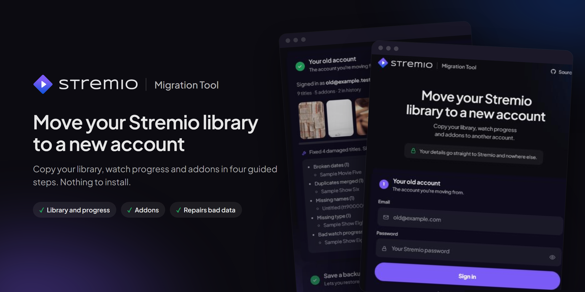
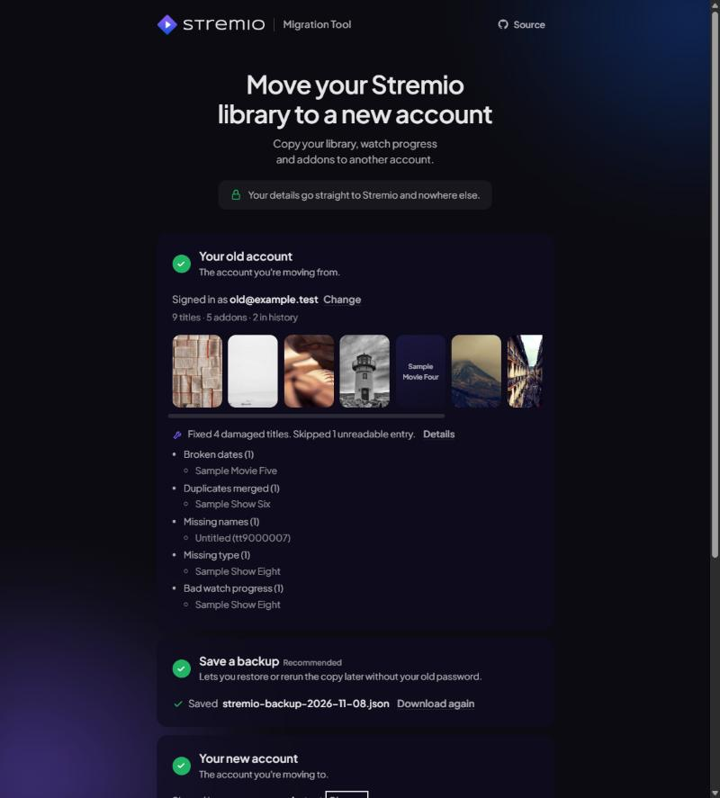

 

   

---

Stremio does not let you change the email address of an account. If you have a new email address, lost access to the old one, or shared an account with a roommate, you normally have to add every title and addon again by hand.

This tool copies your **library**, **watch progress** and **addons** from one Stremio account to another in four guided steps. It can also **repair** an account whose library no longer loads.

## ✨ What it does

| | Feature | Details |
|---|---|---|
| 📚 | **Library and progress** | Every title, with how far you watched and when. |
| 🧩 | **Addons** | Your installed addons, in the same order. |
| 🔀 | **Safe merge** | Adds what is missing. Updates a title only when the old copy is newer. Never removes anything. |
| 🩺 | **Data check** | Finds and fixes damaged entries that can stop Stremio from loading your library. |
| 💾 | **Backup file** | Save your old account to a file. Restore or copy from it later without the old password. |
| ✅ | **Verified** | Reads the new account back after the copy to confirm every item arrived. |

## 🚀 How to use it

1. **Your old account.** Sign in to the account you are moving from. The tool reads your library and addons and checks them. If you already have a backup file, select **Load a backup file instead**.
2. **Save a backup.** Select **Download backup**. This is optional but recommended.
3. **Your new account.** Sign in to the account you are moving to. No account yet? Select **Create a new account**.
4. **Copy to new account.** Choose what to copy and start. The tool confirms when every item has arrived.

When it is finished, sign out of Stremio on your devices and sign in with the new account.

## 🩺 Data check and repair

One damaged item can stop a whole library from loading in the Stremio apps. Before every copy, the tool checks for:

- Duplicate IDs
- Missing names, types or library flags
- Invalid or empty dates
- Invalid watch-progress values
- Damaged or duplicate addons

Problems are fixed automatically, and you get a list of every title that changed. Entries that cannot be read, for example ones without an ID, are skipped.

<b>🔧 Repair a library that will not load</b>

 

1. Sign in to the damaged account in step 1.
2. Select **Fix in this account**, or sign in to the same account again in step 3.
3. Select **Repair account** in step 4.

Only the damaged titles are rewritten. Restart Stremio on your devices afterwards.

## 🔒 Is it safe?

- **Your details go straight to Stremio.** The page sends your email and password only to Stremio's own servers (`api.strem.io`), the same way the Stremio apps do. There is no server of ours in between.
- **Nothing is stored.** No cookies, no tracking, no analytics. Your sign-in is held in the page's memory only, and the page signs out of Stremio when you close the tab. Nothing is saved to disk unless you select **Download backup**.
- **Locked down.** The page loads nothing from other sites, and its security policy only allows it to talk to Stremio.
- **You can read every line.** The whole tool is one [`index.html`](index.html) file.
- **Prefer a local copy?** Download [`index.html`](https://raw.githubusercontent.com/RobbyDock/stremio-migration-tool/main/index.html) and open it in your browser. If it opens as text, use **Save as**. It works the same way as the hosted page.

> [!TIP]
> Always check the address bar shows **robbydock.github.io/stremio-migration-tool** before you sign in. Copies hosted elsewhere are not maintained by this project.

## ❓ FAQ

<b>I signed up with Facebook or Apple. What is my password?</b>

 

These accounts may not have a Stremio password. Open Stremio's sign-in page, select **Forgot password?** and enter the email address of your Facebook or Apple account. Then use that email and the new password here.

<b>Can I run it more than once?</b>

 

Yes. Titles keep their original IDs, so running it again only adds what is missing or newer. Nothing is removed from either account.

<b>Does it change my old account?</b>

 

No. The old account is only read, unless you choose to repair it.

<b>Something went wrong halfway. What now?</b>

 

Select **Try again**. Items that already arrived are not copied twice, so the copy is safe to repeat.

## 📝 Notes

- This tool is unofficial and is not made by, or affiliated with, Stremio.
- It uses the same web API as the Stremio apps. That API is not publicly documented, so a change on Stremio's side may need an update here.
- Found a problem? [Open an issue](https://github.com/RobbyDock/stremio-migration-tool/issues).
