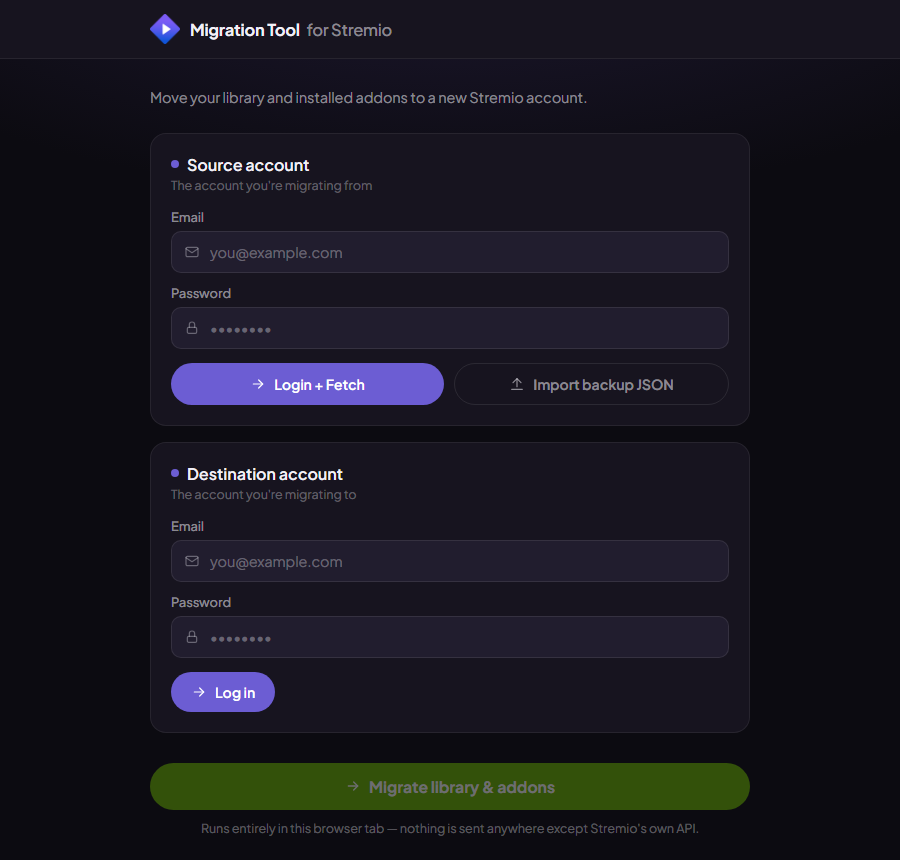
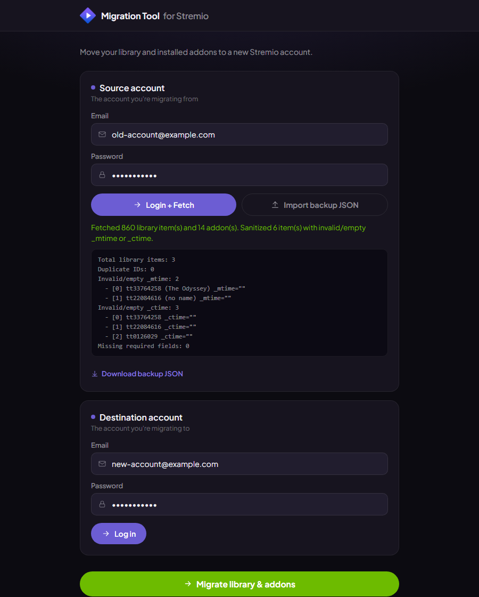

# Stremio Library & Addon Migration

Stremio does not allow you to change the email address associated with an account. If you need to move to a different account, for example because you have a new email address, no longer have access to the original account, or previously shared the account with a roommate, you must normally add all library items and addons again manually.

This tool copies your library and installed addons from one Stremio account to another.

## How it works

The application consists of a single file: index.html.

No installation, build process, or server is required. Open the file in a web browser and it communicates directly with the Stremio API.

No data passes through a third-party service. Your credentials and library data are sent directly from your browser to Stremio's servers, in the same way as the official Stremio applications.

## Usage

1. Open `index.html` in a web browser.
2. In the **Source account** section, sign in to the account that you want to migrate from.
3. Select **Login + Fetch**.
   - The tool retrieves your library and installed addons.
   - The tool validates the retrieved data.
   - The tool provides a **Download backup JSON** link. Downloading a backup is recommended.
   - If you already have a backup file, select **Import backup JSON** instead of signing in again.
4. In the **Destination account** section, sign in to the account that you want to migrate to.
5. Select **Migrate library & addons**.

You can run the migration multiple times safely. Library items keep their original IDs. If an item already exists in the destination account, the tool updates it instead of creating a duplicate.

## Data Validation

The tool validates all retrieved data before migration.

The validation process checks for:

- Duplicate IDs
- Missing required fields
- Invalid timestamps
- Empty timestamps

The tool displays a validation report in the user interface.

If the tool detects invalid or incomplete data, it automatically corrects the issue before migration. This helps prevent corrupted entries from being transferred to the destination account.

## Notes

- The tool does not save data to disk unless you select **Download backup JSON**.
- The tool uses the same Stremio web API as the official applications.
- The Stremio web API is not officially documented as a public API.
- If Stremio changes the API, this tool may require updates to continue working correctly.
