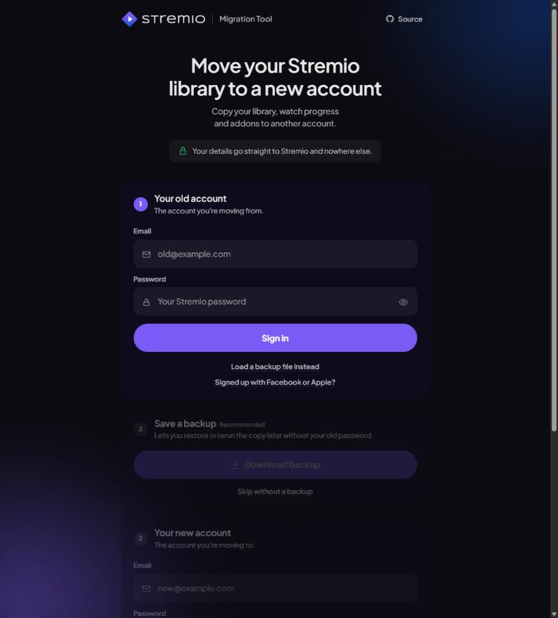
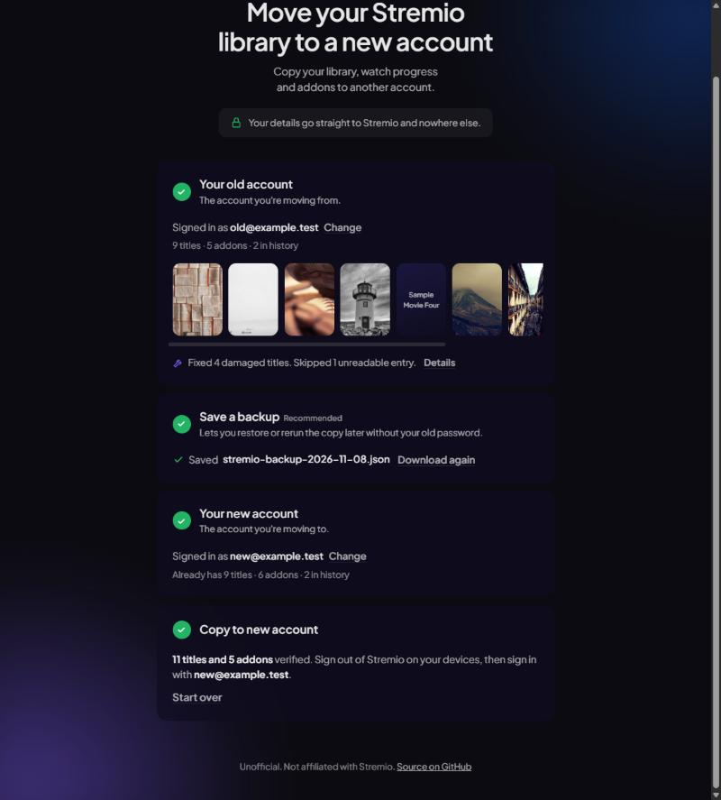

# Stremio Library & Addon Migration

Stremio does not allow you to change the email address associated with an account. If you need to move to a different account, for example because you have a new email address, no longer have access to the original account, or previously shared the account with a roommate, you must normally add all library items and addons again manually.

This tool copies your library, watch progress and installed addons from one Stremio account to another.

**Use it online:** [robbydock.github.io/stremio-migration-tool](https://robbydock.github.io/stremio-migration-tool/)

## How it works

The application consists of a single file: `index.html`.

No installation, build process, or server is required. Use the hosted page above, or download `index.html` and open it in a web browser. The page communicates directly with the Stremio API.

No data passes through a third-party service. Your credentials and library data are sent directly from your browser to Stremio's servers, in the same way as the official Stremio applications.

## Usage

The tool has four steps. Each step unlocks when the previous step is complete.

1. **Your old account.** Sign in to the account that you want to move from.
   - The tool reads your library and installed addons, and checks the data.
   - The tool does not change this account, unless you choose to repair it.
   - If you already have a backup file, select **Load a backup file instead**.
2. **Save a backup.** Select **Download backup**. A backup is recommended.
   - The backup lets you restore your library, or run the copy again, without your old password.
   - To continue without a backup, select **Skip without a backup**.
3. **Your new account.** Sign in to the account that you want to move to.
   - If you do not have a new account, select **Create a new account** first.
4. **Copy to new account.** Select what to copy, then select **Copy to new account**.
   - The tool checks the new account after the copy and confirms that all items arrived.

After the copy, sign out of Stremio on your devices and sign in with the new account.

You can run the copy multiple times safely. Library items keep their original IDs. If an item already exists in the new account, the tool updates it only when the old account's copy is newer. The tool does not remove anything from either account.

### Accounts created with Facebook or Apple

These accounts may not have a Stremio password. To set a password, open Stremio's sign-in page, select **Forgot password?** and enter the email address of your Facebook or Apple account. Then use that email address and password in this tool.

## Data validation

The tool validates all library data before the copy. One damaged item can stop a complete library from loading in the Stremio apps.

The validation process checks for:

- Duplicate IDs
- Missing names, types and library flags
- Invalid or empty timestamps
- Invalid watch-progress values
- Damaged or duplicate addons

If the tool detects invalid or incomplete data, it automatically corrects the issue before the copy. Items that cannot be read, for example items without an ID, are skipped. The tool shows a short summary and a list of all corrected titles.

### Repairing a damaged account

If your library does not load because of damaged data, you can repair the account in place:

1. Sign in to the account in step 1.
2. Select **Fix in this account**, or sign in to the same account again in step 3.
3. Select **Repair account** in step 4.

The tool rewrites only the damaged titles. After the repair, restart Stremio on your devices.

## Notes

- This tool is unofficial. It is not made by, or affiliated with, Stremio.
- The tool does not save data to disk unless you select **Download backup**.
- The tool uses the same Stremio web API as the official applications.
- The Stremio web API is not officially documented as a public API.
- If Stremio changes the API, this tool may require updates to continue working correctly.
